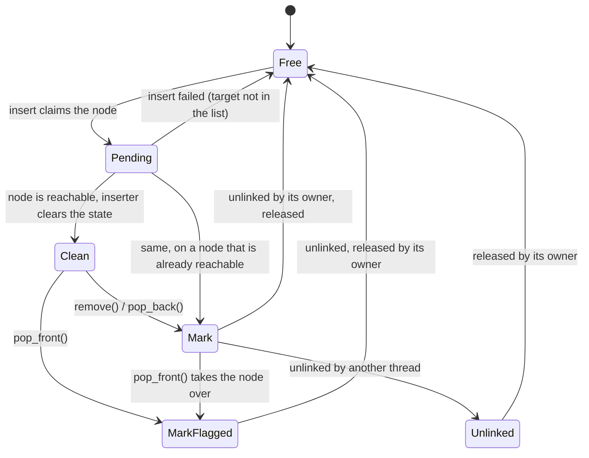

# Lock-free Doubly Linked List: Design

This document describes the algorithm in `include/ut/lock_free_list.h`, why it
is built the way it is, and how it is tested.

## 1. Requirements

- Intrusive list over a fixed, user supplied buffer. Nodes are addressed by
  their index in the buffer, the list never allocates.
- `push_front`, `push_back`, `insert_after`, `insert_before`, `remove`,
  `pop_front`, `pop_back`, `find` and bidirectional iteration, all callable
  concurrently from any number of threads without locks.
- A node can be removed and re-inserted any number of times (free lists, LRU
  lists, queues). This is the hard requirement: it means that **any** value
  that a thread has read can be stale in the worst possible way. The node it
  refers to can have been removed and re-inserted somewhere else in the list,
  and can look exactly the same as before.

## 2. The three rules

Everything follows from three rules.

**The next chain is the truth.** A node is in the list if and only if it is
reachable from the head sentinel via `m_next`. Every operation takes effect
with a single CAS on a single `m_next` word. There is never a moment where the
list is "half updated".

**The prev links are hints.** `m_prev` is repaired after each structural
change. It is exact whenever the list is quiescent and nearly always exact
otherwise, but nothing relies on it: whoever uses a prev link checks it against
the next chain first, and falls back to a search from the head if it is no
good.

**Every CAS target carries a tag.** The tag is incremented on every
modification of the word and is never reset, not even when the node is removed
and re-inserted. If a word still has the value that a thread read earlier then
it was not modified in between. That is the only defence against ABA, and all
the reasoning below depends on it.

The atomics use sequentially consistent ordering. The arguments below are
about interleavings of atomic steps; they do not hold under weaker orderings,
several of them have the "write here, then read there" shape that needs a
total order. There are three exceptions, none of which takes part in such an
argument: the size counter, the store that sets the prev hint of a node before
it is linked (it is published by the CAS that links the node), and the store
that makes a node free again (for every other thread a late release is
indistinguishable from a slow owner).

## 3. Data layout

```
Node (16 bytes)
  m_next: [tag:31][state:3][link:30]
  m_prev: [tag:34][link:30]
```

A link is the index of an item in the buffer. Three values are reserved: the
null link and the links of the head and tail sentinels, which live in the
`List` object. The list is never structurally empty, `head -> tail` always
exists, which removes all the special cases for an empty list and for the
first and last node.

### Node states



| State | Meaning |
|---|---|
| free | Not in a list. Link is null. |
| pending | Claimed by an insert. Possibly reachable already. |
| clean | In the list. |
| mark | Logically deleted by `remove()` or `pop_back()`. The link is frozen. |
| mark_flagged | Logically deleted by `pop_front()`. The link is frozen. |
| unlinked | Was `mark`, has been unlinked by a thread other than its owner. |
| flag | Head sentinel only: the first node is being popped, the link to it is frozen. |

A node whose state is clean (and whose link is not null) is in the list. That
is the property that makes prev hints usable: a thread that finds a clean node
via a hint knows that it is looking at a node that is in the list right now.

## 4. Operations

### 4.1 Insert

```
loop:
  find pred and its next word W, where W points to succ
  new.m_next = (succ, pending)  first attempt: CAS from free, fails if the
                                node is not free. After that the node is
                                private and this is a plain store.
  new.m_prev = pred             private, exact if the CAS below succeeds
  CAS pred.m_next: W -> new     <- linearization point
  CAS new.m_next: pending -> clean
  fix_prev(new -> succ)
```

`insert_after(pred)` reads `W` from `pred` and requires it to be clean, so the
CAS is atomic with "pred is in the list". `push_front` is `insert_after(head)`.

`insert_before(succ)` has to find `pred` first: the prev hint of `succ` if it
checks out, otherwise a search (section 5). `push_back` is
`insert_before(tail)`.

The pending state exists because a node must already name its successor at the
instant that it becomes reachable, so there is a window where the node looks
linked but is not. Without the state another thread holding a pointer to the
item could, for example, mark it as deleted while it is still private.

### 4.2 Remove and pop_back

```
CAS node.m_next: (succ, clean) -> (succ, mark)     <- linearization point
unlink: find pred, CAS pred.m_next: node -> succ
fix_prev(pred -> succ)
release(node)                                       mark -> free
```

After the mark the link is frozen: no node can be inserted after it and its
successor can't be unlinked. Any thread that runs into a marked node unlinks it
(helping), which is what makes the list lock-free: a thread that stalls halfway
through a removal doesn't block anybody. The removing thread returns only once
the node is unlinked, because from then on the caller may re-insert it.

`pop_back()` finds the last node, whose next word points to the tail, and marks
that word. The CAS is therefore atomic with "this is still the last node".

### 4.3 pop_front

There is no such luck at the front: "is the first node" is a property of the
head's next word and "is deleted" is a property of the node's next word. Mark
the node first and something can be inserted in front of it in between.
Therefore `pop_front()` freezes the link first:

```
CAS head.m_next: (first, clean) -> (first, flag)   freeze, the popper owns the node
CAS first.m_next: -> mark_flagged                  <- linearization point, any thread
CAS head.m_next: (first, flag) -> (succ, clean)    any thread
```

While the flag is set nothing can be inserted before the first node and nobody
else can unlink it, so it is still the first node at the instant that it is
marked. Every thread that needs to modify the head's next word completes the
pop first.

Both `remove()`/`pop_back()` and `pop_front()` can go for the same node. The
tie is broken in favour of the flag: `help_pop_front()` overwrites a `mark` with
`mark_flagged`. The thread that set the `mark` notices that the word it wrote
is gone (it compares the whole word, the tag makes it unique forever), unlinks
nothing, and reports that the node was not in the list. The node was deleted at
the instant of the original mark either way, only the owner changed.

### 4.4 find

Walks the next chain (section 5) and returns the first alive item for which the
predicate holds. It unlinks dead nodes on the way like any other walk. This is
what makes it linearizable rather than merely weakly consistent: a `find` that
has walked past a dead node has changed the predecessor's next word, so that an
`insert_before` in front of that dead node, which would otherwise have to be
ordered before the deletion, fails and is retried.

### 4.5 size

Counters that are updated after the fact, striped by thread so that they are
not a point of contention. `size()` adds them up. Exact when the list is
quiescent.

## 5. Walking a list whose nodes move

The walk is the heart of the algorithm, and the reason the first versions of
this list were wrong.

In a list where removed nodes are never re-inserted, a walk can stand on a node
for as long as it likes: the worst that can happen is that the node is deleted,
and its frozen next link still leads back into the list. Here, a node that the
walk is standing on can be removed, re-inserted *behind the walk or far ahead
of it*, and look perfectly healthy. Following its next link teleports the walk.
A search that reports "not found" after such a jump is simply wrong.

The walk therefore maintains this invariant:

> `word` was read from `prev.m_next` at a time when `prev` was in the list.

and advances like this:

```
current = link(word)
cw = current.m_next
if prev.m_next != word: restart            <- validation
if cw is dead: unlink current (CAS prev.m_next: word -> link(cw)), continue
prev, word = current, cw
```

If `prev.m_next` still equals `word` after `current.m_next` was read, then
`current` was the successor of `prev`, and so in the list, when it was read.
The tag is what turns "equals" into "was not modified in between".

If the unlink CAS fails then `prev.m_next` has changed. It is tempting to read
it again and carry on if `prev` looks clean. That is the teleport again: clean
means "in the list now", not "never left". The walk keeps the link that points
to `prev` (the anchor). If the anchor is intact then `prev` never left the
list and the walk continues, otherwise it restarts from the head.

A walk from the head that reaches the tail without meeting a node proves that
the node was not in the list at some instant during the walk. A walk that
starts from a prev hint is only good for a positive answer; it gives up after
a few steps and the search is repeated from the head.

The same staleness has to be dealt with wherever a thread acts on a node that
it does not own. Two examples that the tests found:

- `unlink()` checks that its mark is still in place *after* it has read the
  link that points to the node. In the other order, a node that was taken over,
  recycled and re-inserted in between would be unlinked from its new position.
- A user can pass in a pending node. Whether it is in the list is decided by a
  search, not by its state. "Not in the list" must not be contradicted by the
  pending insert succeeding later *and taking effect in the past*, which an
  `insert_before` does if its target is deleted before the new node is linked.
  Two things prevent that. The insert checks that its target is alive after
  the pending node names it, and the search starts at the head and unlinks
  every dead node on the way: if the target died before the search started, it
  is unlinked when the search ends, and the insert's CAS fails.

### 5.1 Staying O(1) under contention

A search from the head is O(n), and in a list that is being modified by many
threads it keeps restarting. Measured with 64 threads on a list of 65536 items:
about a hundred such searches per second were enough to make the list *slower*
with every thread added. The search is what makes the list lock-free, it must
exist, but it must not run unless a thread is really stalled. There are three
places where an operation could not finish in O(1), and all three are a matter
of waiting a few instructions for another thread:

- **The prev hint is stale.** The thread that changed the link is about to
  repair it. Retry the hint (`UT_LOCK_FREE_LIST_SPIN_LIMIT` times) before
  searching.
- **The node that a thread marked was unlinked by a helper.** The owner can't
  find it via the hint, and proving that a node is *not* in the list takes a
  full search. Therefore the helper says so: after unlinking a marked node it
  moves it to the `unlinked` state (a CAS on the exact marked word, which fails
  harmlessly if the owner has found out by itself and recycled the node).
- **A user passes in a pending node.** The insert is about to complete or to
  fail, and the state changes either way.

The tests set the spin limit to 2 so that the search from the head is
exercised all the time, and are also run with the default.

### 5.2 The ends of the list

Operations in different parts of the list don't touch the same cache lines and
scale with the number of threads. Operations on the same end can't: every
`push_front` has to win a CAS on the one word in the head sentinel. No list
with a single head can scale there, a lock-free one can only avoid getting
worse as threads are added. Two things matter for that:

- **Backoff.** A thread that loses a race for a link waits for a randomized,
  exponentially growing number of `pause` instructions before it retries
  (`UT_LOCK_FREE_LIST_MAX_BACKOFF`). Without it the cache line bounces between
  the cores and the throughput drops with each thread added.
- **No stampede.** A thread that finds a `pop_front` in progress gives the
  owner a moment to finish before it helps. Helping is required for
  lock-freedom; 63 threads helping the same pop at once is a waste.

If the workload is 64 threads hammering one end, use several lists.

## 6. Prev hints

After each CAS that makes `pred.m_next` point to `succ` (insert, unlink,
clearing the pending state), the thread that did the CAS runs:

```
fix_prev(pred, W):          W is the word that the CAS wrote
  loop:
    old = succ.m_prev
    if pred.m_next != W: return        the link is gone, somebody else's job
    if CAS succ.m_prev: old -> pred: return
```

`succ.m_prev` is read *before* the link is validated. Consider a newer link to
the same `succ`, and its fix. The older fix validated before the newer link
existed, so its read of `m_prev` is older still. If the newer fix writes first,
the older CAS fails and the next validation fails too. If the older one writes
first, the newer one overwrites it. Either way the hint for the newest link
wins, which is why the hints are exact once all operations have completed.

When a link is destroyed by a mark or a flag there is no new link yet and the
hint stays stale until the unlink creates one. Readers handle that by following
the prev hints of dead nodes a few hops, then scanning forward, then falling
back to the head.

## 7. Guarantees

- **Linearizability** of `push_front`, `push_back`, `insert_after`,
  `insert_before`, `remove`, `pop_front`, `pop_back` and `find`.
- **Lock-freedom.** Every retry is caused by another thread's successful CAS.
  Individual operations can starve under heavy contention.
- **Ownership.** When `remove`/`pop_*` return an item, no other thread will
  modify its node and the caller may re-insert it immediately.
- **Iterators are weakly consistent.** They are read-only and never help. As
  long as the element that an iterator points to stays in the list, a traversal
  sees every element that is in the list throughout, exactly once and in order.
  If the element is removed, advancing the iterator throws
  `Iterator_invalidated`, or, if the item is back in the list already,
  continues from its new position.

### Limits

- At most 2^30 - 3 items.
- The `m_next` tag has 31 bits. ABA is possible only if a thread stalls in the
  middle of an operation while one specific node is modified exactly a
  multiple of 2^31 times and ends up with the same link and state.
- `insert_before`, `remove` and `pop_back` use the prev hint to find the
  predecessor in O(1). They fall back to a search from the head, which is
  O(n), only if another thread stalls at the wrong moment (section 5.1).
- Throughput at one end of the list is bounded by one cache line (section
  5.2).
- The `List` object is about 4 KB because of the striped counters.

## 8. Testing

### 8.1 Deterministic simulation (`tests/dst_tests.cc`, `tests/sim/sim.h`)

The list is compiled against `sim::Atomic` instead of `std::atomic`
(`UT_LOCK_FREE_LIST_ATOMIC`). Every atomic access is a scheduling point, and
a seeded PRNG decides which simulated thread (a fiber) takes the next step. A
(program, seed) pair always produces the same interleaving, so every failure
can be replayed, traced step by step (`LF_DST_TRACE=1`) and shrunk.

Schedules are generated with two strategies: a context switch with a fixed
probability at every step, and a priority based strategy that runs one thread
until it is demoted at a few random points, which is what finds the bugs that
need a thread to stall for a long time at exactly the wrong moment. Weak CAS
fails spuriously now and then.

The simulation explores sequentially consistent interleavings only. It says
nothing about weak memory orderings, which is one more reason for using
sequentially consistent atomics.

### 8.2 Properties

Test programs are generated: 2 to 4 threads, a handful of operations each,
over a small pool of items so that conflicts and recycling are the norm. After
every run:

1. **Progress.** The run finishes within a step budget.
2. **Linearizability.** A Wing & Gong style search looks for a sequential
   order of the operations, consistent with their real-time order, that
   explains every result and the final contents of the list. The model is a
   `std::vector`.
3. **Quiescent consistency.** Forward traversal, backward traversal and
   `size()` agree; `is_consistent()` holds, which checks what can't be seen
   through the regular interface: every prev link is exact and no operation
   is half done; draining the list returns the same items in the same order
   and leaves every node free.
4. **Conservation.** Every item is in the list or owned by exactly one
   thread.
5. **Iteration.** Concurrent iteration terminates and yields valid items.
   Without concurrent removals it is an exact, in-order view of the items that
   were present when it started.

A failing program is shrunk by removing threads, operations and initial items
for as long as some schedule still fails.

### 8.3 Do the tests test anything?

The suite was checked by breaking the list on purpose, one change at a time:
no validation in the walk, no anchor check, no tag, `unlink()` without the
ownership re-check, no take over state for `pop_front()`, `fix_prev()` without
the link validation and with the read of the prev word moved after it, no fix
after clearing the pending state, no target check in `insert_before()`. Every
one of these is caught, most of them within the first few thousand programs.
When the list changes, this is worth repeating for the code that changed: a
check that can be removed without a test failing is either redundant or
untested, and both are worth knowing.

### 8.4 Real threads (`tests/mt_tests.cc`)

Stress tests with real threads, including one that recycles a small set of
items across all the operations. Run them under ThreadSanitizer as well; the
simulation cannot find data races in code that bypasses the atomics.
